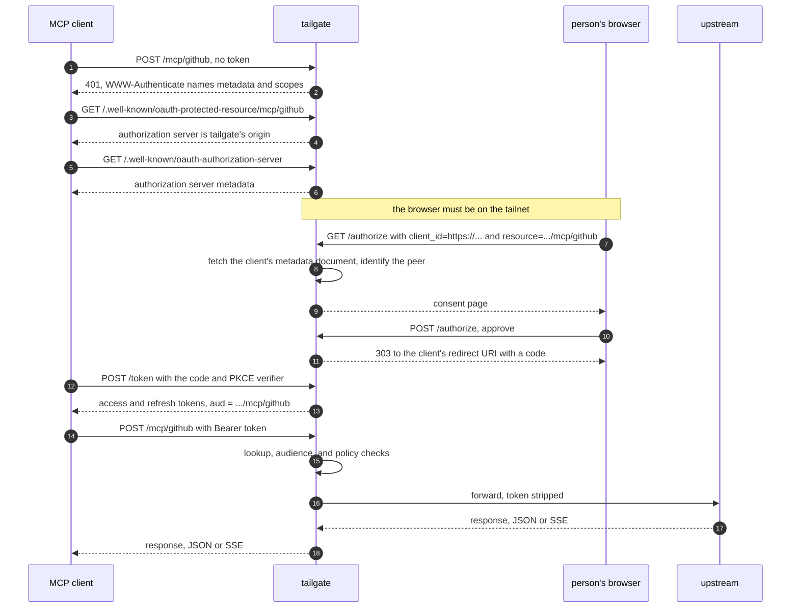

# Deploying tailgate

## Installing

Each `v*` tag publishes `tailgate-darwin-arm64` to its GitHub release, with a `.sha256` file beside it. The binary is built with cgo, signed with the identifier `dev.bendrucker.tailgate` under the hardened runtime, and attested with GitHub build provenance. With mise:

```toml
[tools."github:bendrucker/tailgate"]
version = "latest"
asset_pattern = "tailgate-darwin-arm64"
```

mise strips the platform suffix and installs the binary as `tailgate`. By default it verifies the release's GitHub artifact attestation (`github.github_attestations`), which proves the binary was built in this repository but doesn't check which workflow built it. To require the release workflow itself:

```sh
gh attestation verify "$(mise which tailgate)" \
  --repo bendrucker/tailgate \
  --signer-workflow bendrucker/tailgate/.github/workflows/release.yml
```

`codesign -d -r - "$(mise which tailgate)"` prints the designated requirement, `identifier "dev.bendrucker.tailgate" and certificate leaf = H"<SHA-1>"`. A keychain item's ACL that admits tailgate by code signature checks this requirement. Every release signed with the same certificate satisfies it.

`go install github.com/bendrucker/tailgate@latest` still builds from source, but the result has only the linker's ad-hoc signature and doesn't satisfy a requirement that references the certificate.

### Gatekeeper

The release binary is self-signed and not notarized, and it runs as installed by mise. Gatekeeper assesses a binary only when it has the `com.apple.quarantine` extended attribute. Browsers and other apps that opt into quarantine set it on their downloads. mise downloads over its own HTTP client and doesn't set it. Its github-backend installs have only `com.apple.provenance`, which doesn't trigger an assessment. On Apple silicon the kernel requires a valid signature to execute any binary, and an untrusted self-signed one is valid.

A binary fetched through a browser is quarantined, and Gatekeeper refuses to open it, since no Developer ID signed it. Clear the attribute after verifying the attestation:

```sh
xattr -d com.apple.quarantine tailgate-darwin-arm64
```

### Release Signing Setup

The signing key lives only in the `release` environment's secrets. Setting it up is a one-time, attended step.

Create the environment and restrict it to `v*` tags, so only a release run can read its secrets:

```sh
gh api -X PUT repos/bendrucker/tailgate/environments/release \
  -F 'deployment_branch_policy[protected_branches]=false' \
  -F 'deployment_branch_policy[custom_branch_policies]=true'
gh api -X POST repos/bendrucker/tailgate/environments/release/deployment-branch-policies \
  -f name='v*' -f type=tag
```

Generate the certificate and upload it without printing any secret. Homebrew's OpenSSL is required: the system LibreSSL lacks `-legacy`, and the legacy PKCS#12 encryption is the form `security import` accepts.

```sh
openssl=/opt/homebrew/bin/openssl
umask 077
dir="$(mktemp -d)"
"$openssl" req -x509 -newkey rsa:3072 -noenc -days 3650 \
  -keyout "$dir/key.pem" -out "$dir/cert.pem" \
  -subj '/CN=tailgate Code Signing' \
  -addext 'basicConstraints=critical,CA:FALSE' \
  -addext 'keyUsage=critical,digitalSignature' \
  -addext 'extendedKeyUsage=critical,codeSigning'
"$openssl" rand -base64 32 > "$dir/password"
"$openssl" pkcs12 -export -legacy -name 'tailgate Code Signing' \
  -inkey "$dir/key.pem" -in "$dir/cert.pem" \
  -passout "file:$dir/password" -out "$dir/signing.p12"
base64 -i "$dir/signing.p12" | gh secret set SIGNING_P12_BASE64 --env release --repo bendrucker/tailgate
gh secret set SIGNING_P12_PASSWORD --env release --repo bendrucker/tailgate < "$dir/password"
"$openssl" x509 -in "$dir/cert.pem" -noout -fingerprint -sha1 \
  | cut -d= -f2 | tr -d : | tr 'A-F' 'a-f' \
  | gh variable set SIGNING_CERT_SHA1 --env release --repo bendrucker/tailgate
rm -rf "$dir"
```

`SIGNING_CERT_SHA1` is public. The workflow refuses a p12 whose certificate doesn't match it, then checks that the signed binary's designated requirement names it. Run the release workflow on a tag to confirm the setup.

Replacing the certificate changes the designated requirement. Every keychain ACL that trusted the old one stops trusting the next release.

## Tailnet Prerequisites

Grant the `funnel` node attribute to tailgate's node in the tailnet policy. Without it, Funnel fails at the public edge.

The node key is the longest-lived credential in the deployment. After the first join it replaces the auth key entirely, and anything that can read it is tailgate on your tailnet. How long it lasts follows from `node.tags`, which also states the node's identity in the config rather than leaving it implicit in whichever auth key minted the node.

Untagged, the key expires on the tailnet's [key expiry](https://tailscale.com/kb/1028/key-expiry) schedule, six months by default, and the deployment goes offline until someone reauthenticates it. [Applying a tag disables expiry by default](https://tailscale.com/docs/features/access-control/key-expiry), which keeps tailgate up and leaves the credential unbounded.

Prefer untagged with a scheduled rejoin. Tag the node when a rejoin is impractical, or when a shared tailnet needs the node's identity in policy more than it needs the bound. An untagged node with expiry disabled by hand is the one arrangement with neither property. The control server decides whether a node may adopt a tag it advertises, so grant the tag in your tailnet policy.

## Running as a Service

The config file and `state_dir` must be readable only by their owner, and tailgate refuses to start otherwise. The config holds every stdio upstream's credentials in `env`, and `state_dir` holds the node key and the TLS private key, so `chmod 600` on the config and `chmod 700` on the directory are part of installing it. `tsnet` creates `state_dir` at `0700` itself but leaves an existing directory at whatever mode it had.

Set `TS_AUTHKEY` for the first start so the node joins unattended. The node key persists in `state_dir`, so later starts never log in again. A launchd sketch:

```xml
<dict>
  <key>Label</key><string>com.bendrucker.tailgate</string>
  <key>ProgramArguments</key>
  <array>
    <string>/usr/local/bin/tailgate</string>
    <string>-config</string>
    <string>/etc/tailgate.hujson</string>
  </array>
  <key>EnvironmentVariables</key>
  <dict>
    <key>TS_AUTHKEY</key><string>tskey-auth-...</string>
  </dict>
  <key>RunAtLoad</key><true/>
  <key>KeepAlive</key><true/>
  <key>ExitTimeOut</key><integer>60</integer>
</dict>
```

The systemd equivalent:

```ini
[Service]
ExecStart=/usr/local/bin/tailgate -config /etc/tailgate.hujson
ExecReload=/bin/kill -HUP $MAINPID
Environment=TS_AUTHKEY=tskey-auth-...
Restart=always
TimeoutStopSec=60
```

`SIGINT` and `SIGTERM` stop the listener, drain in-flight requests and open SSE streams for up to 30 seconds, then wait up to 10 more for connections that never reached a transport. The supervisor's kill timeout must exceed the 40-second total.

## Reloading

`SIGHUP` reloads the config file in place, so editing it never restarts the process or invalidates a token:

```sh
launchctl kill SIGHUP system/com.bendrucker.tailgate
```

A reload rebuilds the routes from the file. Upstreams added appear, upstreams removed answer `404`, and every upstream gets a fresh transport while the previous ones drain in the background for up to 30 seconds. `policy` and `favicon` take effect on the next request.

Everything under `node` is fixed for the life of the process, since the tailnet node is joined once. A reload whose `node` section differs is refused, and so is a file that fails to load or a configuration whose routes fail to build. Each refusal is logged with its reason and leaves the running configuration in service, so a mistyped file never takes tailgate down.

Tokens survive a reload, because the store holding them is outside what a reload rebuilds. Refresh tokens also survive a restart when `state_dir` is set, since they are kept in `state_dir/refresh-tokens.json`. Sessions survive neither. A stateful client's next request answers `404`, the MCP signal to re-initialize, and a stdio child of the previous configuration is terminated once its in-flight requests finish.

## Startup Failures

Nothing serves until every startup step succeeds, so a failure here is downtime rather than an unauthenticated window.

- A node with no auth key and no saved state exits after 90 seconds rather than waiting on a login nobody is there to complete. Run once with `-open-login` on a machine with a browser to authorize interactively, which waits five minutes.
- Setting `node.tailnet` makes tailgate compare the name the join reports against it. A mismatch stops it, because a control server that suffixes a taken hostname shifts every resource URI away from the URL every client was configured with.
- An optional top-level `favicon` names an image file, served at `/favicon.ico` under a root page linking it. A path that cannot be read, or that is zero bytes, fails startup. Without one, the icon crawlers that supply a client like claude.ai with a connector icon fall back to Tailscale's logo for a `*.ts.net` node.
- A config file from a release that used tsidp still carries an `oidc` section. Unknown keys refuse the whole file rather than being dropped, so delete that section before upgrading. The `tailgate grant` command is gone along with it, and the tsidp client and ACL grant it wrote are no longer read.

## Connecting Clients

Nothing is registered and there is no client secret. A client identifies itself with a [Client ID Metadata Document](https://datatracker.ietf.org/doc/draft-ietf-oauth-client-id-metadata-document/), which claude.ai and FastMCP do. Give the client the upstream's URL, `https://<node>.<tailnet>.ts.net/mcp/<name>`, and it discovers the authorization server from the `401`. A client that asks for an authorization server URL outright takes tailgate's own origin.

When the client sends you to authorize, open the link on a device that is on the tailnet. The consent page identifies you by the connection, and a browser arriving over the public internet is told to move. The page names the client, the host publishing its metadata document, the host the authorization code will be sent to, and the upstream. Approving issues a token for that one upstream, and the client refreshes it on its own for thirty days.

Policy is allow-only, so an upstream with no rule is reachable by nobody. A `sub` match is your bare decimal Tailscale user ID, and an `email` match is your tailnet login name. A `claim` map matches the rest of what a token carries: `name`, `scope`, `client_id`, and `aud`.

## Getting a Token



A client that skips discovery joins at step 5, probing `/.well-known/oauth-authorization-server` at the MCP origin.

## Node Key Rotation

There is no rotate command. Rotation is a rejoin, and the order matters.

1. Delete the node in the tailnet admin console.
2. Delete `state_dir`.
3. Start tailgate with a fresh `TS_AUTHKEY`, or once with `-open-login`.

Deleting the node first frees the hostname. A name still held comes back from the control server with a suffix appended, and every canonical resource URI is built from the name the join reports, so a rejoin landing on `tailgate-1` shifts every audience away from the URL every client was configured with. With `node.tailnet` set, tailgate catches that and refuses to serve rather than denying every request at the audience check. It cannot name the stale node behind the mismatch, so check the admin console.

## Limits

Request bodies are capped at 1 MiB and session bindings expire after an hour. Neither has a config key. On a stdio upstream, `max_children` (default 4) and `idle_timeout` (default 5m) are the only tunable limits. `max_children` bounds the caller's concurrently busy sessions: at the cap, a new session evicts the caller's least recently used idle one rather than waiting out `idle_timeout`.

## Operating Notes

The Funnel listener also accepts tailnet peers dialing the same port, which is how the consent page knows who is approving. An MCP request still needs a bearer token whichever way it arrives, since tailnet identity is used only to authorize a client, never in place of a token.

Setting `TAILGATE_TSNET_DEBUG` to any non-empty value routes the embedded node's internal logs to `slog`. Funnel ingress problems show up there.

[architecture.md](architecture.md) maps the internals. [security.md](security.md) states the trust boundaries and the known limitations, including how long revocation lags.
